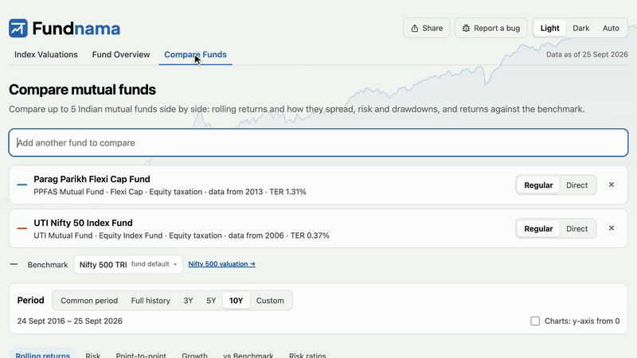
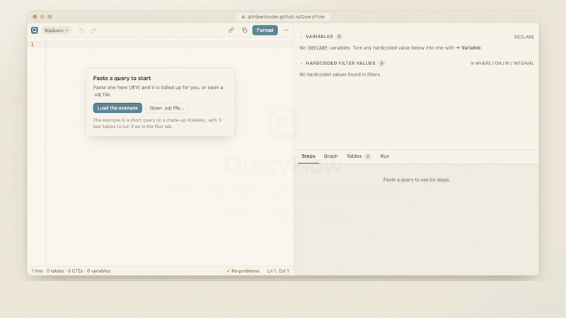

## Hi, I'm Abhijeet

I work on data end to end, from analytics engineering (pipelines, data models) to dashboards and forecasts. I've led analytics teams across growth, monetization and revenue, and was previously at Meta.

Outside work I build small tools for problems I run into myself. They usually run in the browser and cost nothing to use.

### Things I've built

**[Fundnama](https://fundnama.in)**: compares Indian mutual funds and tracks index valuations. Rolling returns, portfolio overlap, and how often active funds beat an index fund, built only on free public data.

**[QueryFlow](https://abhijeetcodes.github.io/QueryFlow/)**: a SQL editor for reading big, inherited queries. It formats the SQL, draws how the tables and CTEs join, and can run BigQuery SQL on small test tables. Your SQL never leaves the browser. ([code](https://github.com/AbhijeetCodes/QueryFlow))

Also two Claude skills: [source-to-book](https://github.com/AbhijeetCodes/source-to-book) turns long podcasts and articles into a readable book; [make-a-course](https://github.com/AbhijeetCodes/make-a-course-skill) turns a codebase into a course.

### Elsewhere

[LinkedIn](https://www.linkedin.com/in/abinotronix)
